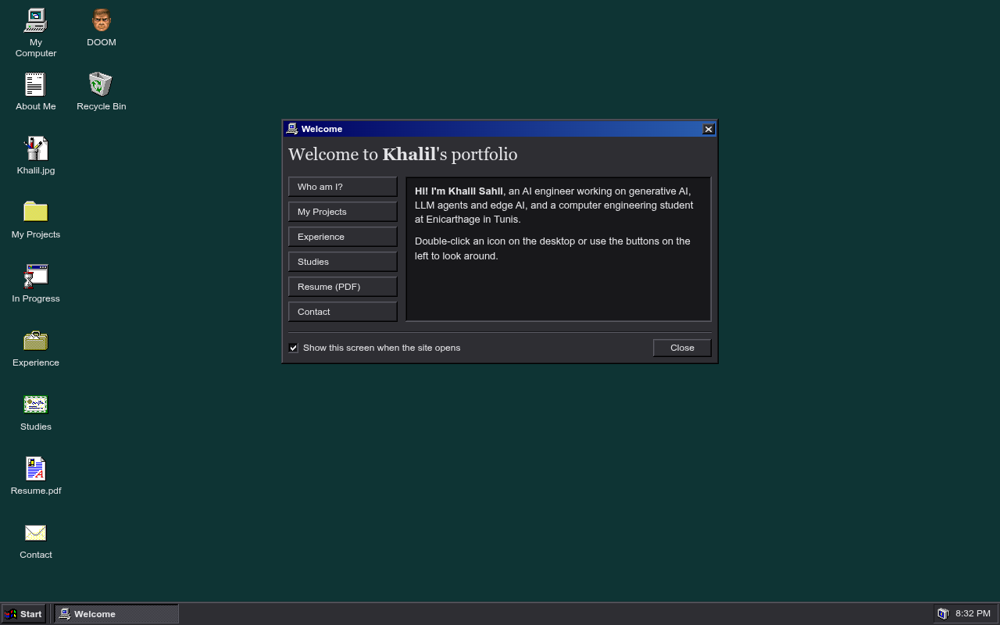
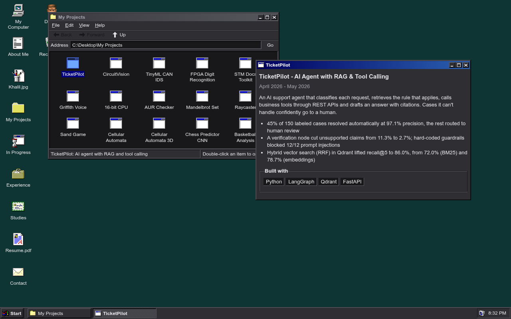
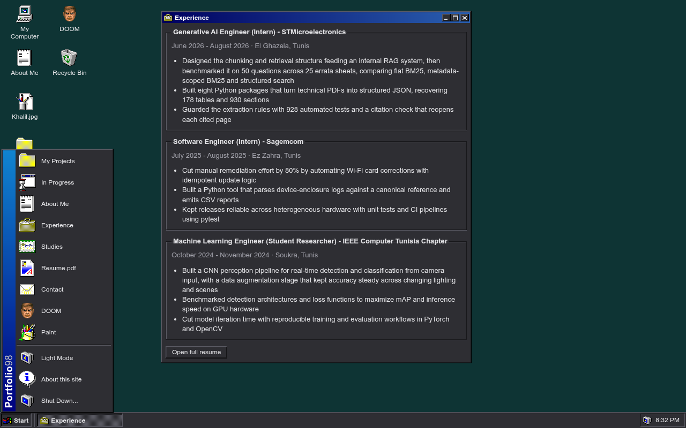
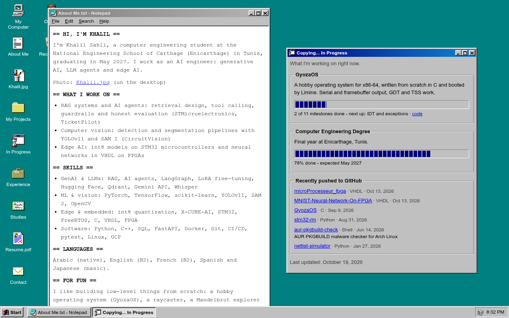
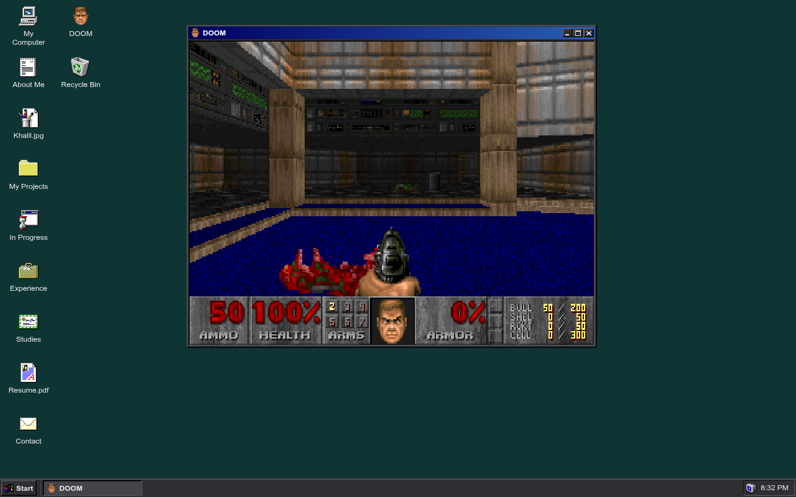
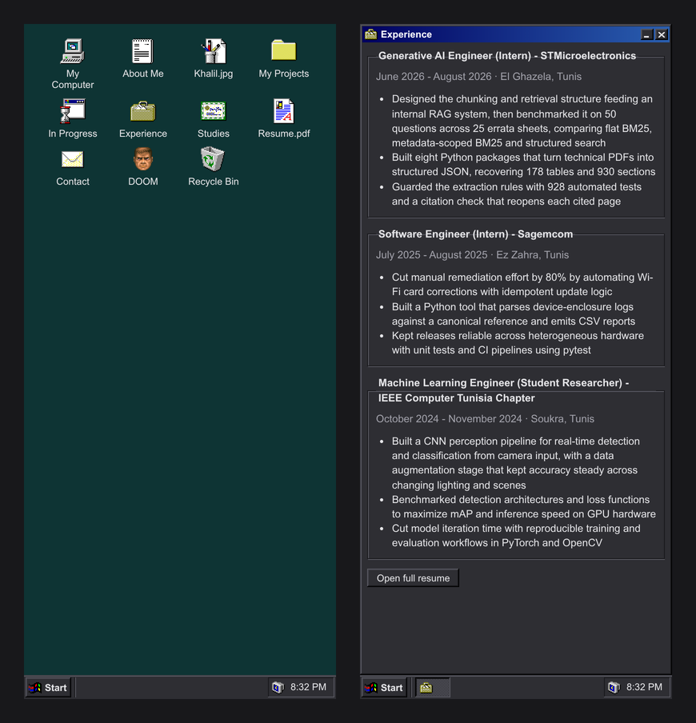

# Portfolio 98

My personal portfolio, built as a Windows 98 desktop. Projects, experience, studies and my resume open as draggable windows, and DOOM is playable from the desktop.

**Live:** https://si7li.github.io/Portfolio_Win98/



## Screenshots

| | |
|---|---|
|  |  |
|  |  |

On phones, windows open full screen one at a time:



## Features

- Draggable windows with minimize, maximize and close, a taskbar, a Start menu and a clock
- Every window has its own link, for example [`#projects`](https://si7li.github.io/Portfolio_Win98/#projects)
- A working Explorer: type a path like `C:\Desktop\My Projects` in the address bar, go Back / Forward / Up, and use real File, Edit, View and Help menus (keyboard too: Alt+letter, arrows, Esc)
- Notepad menus that work: Save As downloads the text, Copy, Select All, Word Wrap, Find / Find Next
- A working copy of Windows 98 Paint ([`paint.js`](paint.js)): all 16 tools, the options box, left/right-click colors, Undo, Cut/Copy/Paste, Flip/Rotate/Invert, Attributes, and New/Open/Save As. Open `Khalil.jpg` on the desktop to doodle on my photo
- My Computer with drives (the floppy and CD are "not ready", of course), `C:`, and a Control Panel whose Display Properties switch the color scheme
- Dark theme by default, with a light theme toggle in the tray
- Playable DOOM (shareware) in a DOS emulator, loaded only when its window opens
- Stays up to date on its own: my recent repos, GyozaOS progress and degree progress are read live from GitHub and today's date, with [`data/github.json`](data/github.json) as a fallback ([`scripts/update_data.py`](scripts/update_data.py) refreshes it)
- Works on phones and with the keyboard
- Plain HTML, CSS and JavaScript: no frameworks and no build step

## Run it locally

```bash
python3 -m http.server 8000
```

Then open http://localhost:8000. Opening `index.html` directly works too, except for DOOM, which needs a web server.

## Credits

- Windows 98 icons from [alexh/vintage-icons](https://github.com/alexh/vintage-icons) (originally by Microsoft)
- DOOM shareware v1.9 by id Software, run with [js-dos](https://github.com/caiiiycuk/js-dos) (GPL-2.0). See [`doom/README.txt`](doom/README.txt)
